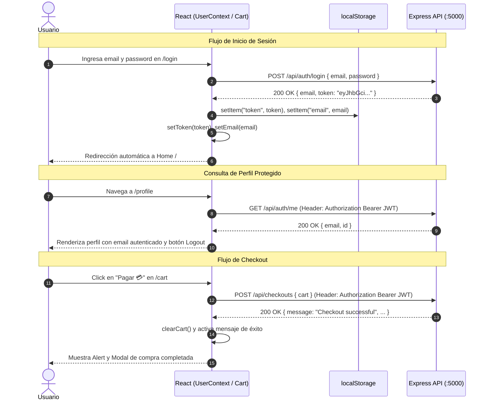

# 🍕 Hito 8 - Pizzería Mamma Mía 
### (Implementación de Autenticación Real con JWT, UserContext, Checkout y Rutas Protegidas)

Este proyecto corresponde al **Hito 8 (Hito Final)** del módulo de React, enfocado en la implementación de **autenticación y autorización real con el backend mediante JSON Web Tokens (JWT)**, integración de métodos asíncronos en **`UserContext`**, consumo de rutas protegidas mediante cabeceras HTTP (`Authorization: Bearer <token>`), gestión reactiva de sesión en la barra de navegación, visualización del perfil del usuario y finalización del flujo de compra (**checkout**) con feedback visual y diseño 100% responsivo.

---

## 🔗 Enlaces Oficiales

- **Repositorio en GitHub**:
  - [https://github.com/vn-vrgs/mamma-mia.git](https://github.com/vn-vrgs/mamma-mia.git)
- **Despliegue en Vivo (Vercel)**: 
  - [https://mamma-mia-gamma.vercel.app/](https://mamma-mia-gamma.vercel.app/)

---

## 📋 Requerimientos del Hito 8 Implementados (10 / 10 Puntos)

### 1. Métodos `login` y `register` en `UserContext` (2 puntos)
- [x] **Consumo de `/api/auth/login`:** Se implementó el método asíncrono `login(email, password)` en `src/context/UserContext.jsx`, despachando una petición `POST` al backend con el cuerpo JSON `{ email, password }`.
- [x] **Consumo de `/api/auth/register`:** Se implementó el método asíncrono `register(email, password)` en `UserContext`, despachando una petición `POST` al endpoint `/api/auth/register`.
- [x] **Almacenamiento de Estados y Persistencia:** Ambas rutas retornan `{ email, token }`. El contexto almacena tanto el `token` JWT como el `email` en sus respectivos estados de React (`useState`), y los sincroniza en `localStorage` para garantizar la persistencia de sesión ante recargas de página.

### 2. Método `logout` en `UserContext` (1 punto)
- [x] **Limpieza Integral de Sesión:** Se implementó la función `logout()` en `UserContext`, la cual restablece los estados `token` a `null`, `email` a `null` y `user` a `null`.
- [x] **Remoción de Credenciales Locales:** Limpia las claves `'token'` y `'email'` alojadas en `localStorage`, revocando el acceso inmediato a rutas y recursos protegidos.

### 3. Método para Obtener el Perfil del Usuario en `UserContext` (1 punto)
- [x] **Consumo de `/api/auth/me`:** Se desarrolló el método asíncrono `getProfile()` dentro de `UserContext`.
- [x] **Cabecera de Autorización JWT:** Despacha la petición `GET /api/auth/me` inyectando la cabecera `Authorization: Bearer ${token}`.
- [x] **Sincronización de Perfil y Revocación Automática:** Si la respuesta es exitosa (`200 OK`), actualiza el estado del usuario (`user` y `email`). Si el token es inválido o ha expirado (`401 Unauthorized`), dispara automáticamente `logout()` para proteger la aplicación.

### 4. Implementación en las Páginas `Login.jsx` y `Register.jsx` (2 puntos)
- [x] **Página de Login (`src/pages/Login.jsx`):** Consume el método `login` de `UserContext`. Cuenta con validación de campos vacíos y longitud mínima de contraseña ($\ge 6$ caracteres). Maneja estados de carga (`isSubmitting` con spinner animado), control de errores provenientes de la API y retroalimentación interactiva vía `NotificationModal`.
- [x] **Página de Register (`src/pages/Register.jsx`):** Consume el método `register` de `UserContext`. Valida coincidencia exacta de contraseñas y requisitos de seguridad. Al registrarse exitosamente, almacena el token, notifica al usuario e inicia la sesión en el sistema.
- [x] **Custom Hook `useInput` Integrado:** En consonancia con la guía oficial de la clase, se creó y aplicó el hook reutilizable `src/hooks/useInput.js` para la gestión declarativa y limpia de los campos de entrada.

### 5. Visualización de Email y Cierre de Sesión en `Profile.jsx` (1 punto)
- [x] **Muestra del Email Autenticado:** La vista `src/pages/Profile.jsx` consume el `email` del usuario autenticado directamente desde `UserContext` y ejecuta `getProfile()` en un `useEffect` al montar el componente.
- [x] **Botón para Cerrar Sesión:** Incluye el botón interactivo **"🔒 Cerrar sesión"** que invoca `logout()` de `UserContext`, redirigiendo reactivamente al usuario a la página de `/login`.

### 6. Cierre de Sesión desde el Botón del `Navbar` (1 punto)
- [x] **Logout en el Navbar (`src/components/Navbar.jsx`):** El botón **"🔒 Logout"** está vinculado directamente al método `logout` de `UserContext`.
- [x] **Reactividad Instantánea:** Al hacer click, el token pasa a `null`, transformando instantáneamente los enlaces del menú de navegación (desaparecen *Profile* y *Logout*, y reaparecen *Login* y *Register*).

### 7. Envío del Carrito al Backend en `Cart.jsx` (1 punto)
- [x] **Consumo de `/api/checkouts`:** Se implementó la función asíncrona `handleCheckout` en `src/pages/Cart.jsx`.
- [x] **Petición con Autenticación Bearer:** Realiza un `POST` al endpoint `http://localhost:5000/api/checkouts`, adjuntando en los encabezados `Authorization: Bearer ${token}` y en el cuerpo JSON `{ cart }`.
- [x] **Validación y Estado:** El botón "Pagar 💳" permanece deshabilitado si el usuario no tiene token activo, si el carrito está vacío o mientras se procesa la solicitud (`loadingCheckout`).

### 8. Mensaje de Éxito en `Cart.jsx` al Realizar la Compra (1 punto)
- [x] **Feedback Dual de Confirmación:** Tras recibir la respuesta exitosa del servidor, `Cart.jsx` despliega tanto una alerta destacada en pantalla (`<Alert variant="success">`) como la ventana modal de celebración (`<NotificationModal>`).
- [x] **Vaciado de Carrito:** Al concretar la compra, se invoca automáticamente el método `clearCart()` de `CartContext`, dejando el carrito listo para una nueva orden.

---

## 🗺️ Matriz de Endpoints y Consumo API

| Endpoint | Método HTTP | Header Requerido | Payload / Parámetros | Respuesta Esperada |
| :--- | :---: | :--- | :--- | :--- |
| `/api/auth/login` | `POST` | `Content-Type: application/json` | `{ "email": "...", "password": "..." }` | `{ "email": "...", "token": "..." }` |
| `/api/auth/register` | `POST` | `Content-Type: application/json` | `{ "email": "...", "password": "..." }` | `{ "email": "...", "token": "..." }` |
| `/api/auth/me` | `GET` | `Authorization: Bearer <token>` | Ninguno | `{ "email": "...", "id": "..." }` |
| `/api/checkouts` | `POST` | `Authorization: Bearer <token>` | `{ "cart": [...] }` | `{ "message": "Checkout successful", ... }` |
| `/api/pizzas` | `GET` | Libre | Ninguno | `[ { "id": "p001", "name": "...", ... } ]` |
| `/api/pizzas/:id` | `GET` | Libre | Parámetro de ruta `:id` | `{ "id": "p001", "name": "...", ... }` |

---

## 🔐 Credenciales de Prueba

Para probar el inicio de sesión contra el backend de la academia, se pueden utilizar las siguientes credenciales pre-configuradas:

```json
{
  "email": "test@test.com",
  "password": "123123"
}
```

O bien, registrar un usuario nuevo en `/register`, el cual será almacenado en la base de datos `db/users.json` generando su respectivo token JWT.

---

## 🏗️ Diagrama de Flujo: Autenticación JWT y Checkout



---

## 📁 Estructura Actualizada del Proyecto

```text
mamma-mia/
├── controllers/                  # Controladores Backend (auth, checkout, pizza)
├── db/                           # Persistencia en archivos JSON (users.json, pizzas.json)
├── middlewares/                  # auth.middleware.js (Validación de tokens JWT)
├── models/                       # Modelos de acceso a datos
├── routes/                       # Enrutadores Express (auth.route, checkout.route, etc.)
├── src/
│   ├── assets/                   # Imágenes y recursos visuales
│   ├── components/               # Componentes modulares y reutilizables
│   │   ├── CardPizza.jsx         # Card de catálogo con botón Ver Más dinámico
│   │   ├── Footer.jsx            # Pie de página responsivo
│   │   ├── Header.jsx            # Banner visual de cabecera
│   │   ├── Navbar.jsx            # 🌟 Barra de navegación con control reactivo de sesión
│   │   └── NotificationModal.jsx # Modal estilizado para feedback de operaciones
│   ├── context/                  # Gestión de estado global con Context API
│   │   ├── CartContext.jsx       # Estado del carrito, cantidades, total y clearCart
│   │   ├── PizzaContext.jsx      # Catálogo de pizzas y fallback local resiliente
│   │   └── UserContext.jsx       # 🌟 Métodos login, register, logout, getProfile y token JWT
│   ├── hooks/                    # 🌟 Custom Hooks reutilizables
│   │   └── useInput.js           # Hook para control declarativo de inputs de formulario
│   ├── pages/                    # Vistas y pantallas principales
│   │   ├── Cart.jsx              # 🌟 Checkout asíncrono con JWT y mensaje de éxito
│   │   ├── Home.jsx              # Catálogo principal de pizzas
│   │   ├── Login.jsx             # 🌟 Formulario de login conectado a UserContext
│   │   ├── NotFound.jsx          # Error 404
│   │   ├── Pizza.jsx             # Vista de detalle con useParams
│   │   ├── Profile.jsx           # 🌟 Perfil con email de sesión y botón de logout
│   │   └── Register.jsx          # 🌟 Formulario de registro conectado a UserContext
│   ├── utils/                    # Formateador de moneda en pesos chilenos (CLP)
│   ├── App.css                   # Estilos personalizados y tema oscuro moderno
│   ├── App.jsx                   # Enrutamiento y protección de rutas con Navigate
│   ├── index.css                 # Importación de Bootstrap y variables globales
│   ├── main.jsx                  # Montaje con BrowserRouter y Providers anidados
│   └── pizzas.js                 # Catálogo local de respaldo
├── index.html                    # HTML5 base
├── index.js                      # 🌟 Servidor Backend Express en puerto 5000
├── package.json                  # Dependencias del frontend y scripts del servidor
├── vite.config.js                # Configuración de Vite
└── README.md                     # Documentación completa del proyecto
```

---

## 🚀 Instrucciones de Ejecución

### 1. Clonar el Repositorio e Instalar Dependencias
```bash
git clone https://github.com/vn-vrgs/mamma-mia.git
cd mamma-mia
npm install
```

### 2. Iniciar el Servidor Backend (API REST en Puerto 5000)
En una terminal, ejecute:
```bash
npm run server
```
*O alternativamente:*
```bash
node index.js
```
> El backend quedará escuchando en `http://localhost:5000` con los endpoints `/api/auth`, `/api/checkouts` y `/api/pizzas`.

### 3. Iniciar la Aplicación Frontend (Vite en Puerto 5173)
En otra terminal, ejecute:
```bash
npm run dev
```
> Abra su navegador en [http://localhost:5173/](http://localhost:5173/).

---

## 📱 Diseño Web Responsivo

La interfaz está construida siguiendo las mejores prácticas de **Mobile First** y **Responsive Web Design**:
- **Dispositivos Móviles (< 576px):** Formulario de login y registro en tarjetas de ancho completo con padding adaptable, Navbar colapsable tipo hamburguesa, botones de acción en una columna accesible y alertas táctiles.
- **Tablets (576px - 991px):** Grillas fluidas de 2 columnas para el catálogo de pizzas y paneles de resumen optimizados en el carrito de compras.
- **Escritorio ($\ge$ 992px):** Grillas de 3 columnas para pizzas, menús horizontales con indicadores activos (`NavLink`) dorados, y tarjetas de perfil centradas con tipografía clara y contrastada.

---

## ✍️ Autor
Desarrollado para la evaluación del **Hito 8 - Autenticación y Autorización con JWT** en la carrera Full Stack - **Academia Desafío Latam**.
