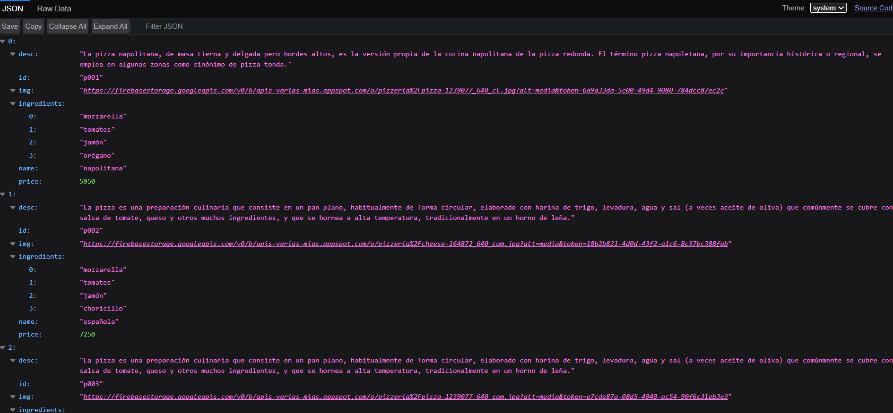
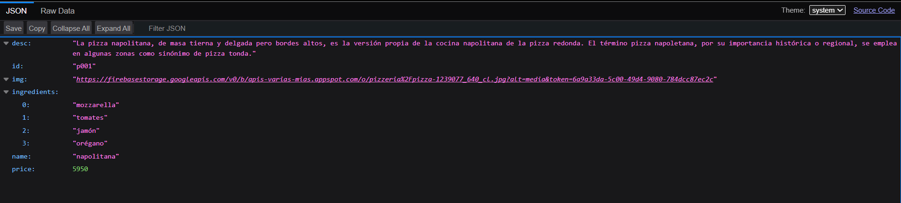

# 🍕 Hito 4 - Pizzería Mamma Mía 
### (Consumo de APIs con React)


Este proyecto corresponde al **Hito 4** del módulo de React, en el cual se valida e implementa el **Consumo de APIs externas** mediante el uso de Hooks (`useEffect`, `useState`) y la API `fetch` en la aplicación web de **Pizzería Mamma Mía**.

---


## 🔗 Enlaces Oficiales

- **Repositorio en GitHub**:
  -  [https://github.com/vn-vrgs/mamma-mia.git](https://github.com/vn-vrgs/mamma-mia.git)
- **Despliegue en Vivo (Vercel)**: 
  - [https://mamma-mia-gamma.vercel.app/](https://mamma-mia-gamma.vercel.app/)

---

## Evidencias comprobadas en mi equipo local

### Retorna el arreglo de 6 pizza


### Retorna el objeto detallado de la pizza Napolitan



---


## 📋 Requerimientos Implementados

### 1. Componente `Home.jsx`
- [x] **Consumo de API:** Realiza una petición `GET` a `http://localhost:5000/api/pizzas` al momento de montar el componente.
- [x] **Hook `useEffect`:** Utiliza `useEffect` con un arreglo de dependencias vacío `[]` para ejecutar la consulta a la API únicamente en la fase de montaje.
- [x] **Estado Dinámico:** Reemplaza el arreglo estático de `pizzas.js` por un estado `pizzas` actualizado dinámicamente con la respuesta de la API.
- [x] **Renderizado Dinámico:** Muestra el catálogo de pizzas renderizando componentes `CardPizza` por cada pizza recibida.
- [x] **Manejo de Estados de Carga y Error:** Incluye indicadores visuales (spinners y alertas de error) en caso de problemas de red o conexión con el backend.

### 2. Componente `Pizza.jsx`
- [x] **Consumo de API Individual:** Realiza una petición `GET` a `http://localhost:5000/api/pizzas/p001` (o un ID dinámico) para obtener el detalle de una pizza específica.
- [x] **Hook `useEffect`:** Ejecuta la consulta a la API al montar el componente utilizando `useEffect`.
- [x] **Visualización Completa:** Muestra todos los campos requeridos:
  - 🍕 **Nombre** de la pizza.
  - 💰 **Precio** formateado (`formatCurrency`).
  - 🧀 **Ingredientes** (renderizados como etiquetas/badges).
  - 🖼️ **Imagen** de alta calidad.
  - 📝 **Descripción** detallada de la pizza.
  - 🛒 **Botón "Añadir"** para agregar al carrito de compras.

### 3. Integración y Navegación en `App.jsx` y `Navbar.jsx`
- [x] **Navegación Interactiva:** Permite cambiar fácilmente entre la vista del catálogo (`Home`), la vista en detalle (`Pizza`), el carrito (`Cart`), el registro (`RegisterPage`) y el inicio de sesión (`LoginPage`).
- [x] **Compatibilidad con Evaluación:** Permite alternar y visualizar tanto `Home.jsx` como `Pizza.jsx` de forma dinámica o mediante comentarios en el JSX de `App.jsx`.

---

## 🛠️ Tecnologías Utilizadas

- **React 18** (Vite + React)
- **Hooks de React:** `useState`, `useEffect`
- **JavaScript (ES6+)** / `async` - `await` / `fetch` API
- **React Bootstrap 5** & **Bootstrap Icons**
- **Node.js** & **Express** (para el servidor backend de pizzas)

---

## 🚀 Instrucciones de Ejecución

Para probar el proyecto completo en tu entorno local, sigue estos pasos:

### 1. Levantar el Backend (API de Pizzas)
Navega a la carpeta del backend (`Backend- Pizzas`) e inicia el servidor en el puerto **5000**:

```bash
cd "c:\App\Latam\FullStack\Modulo4\sem04\codigos\Backend- Pizzas"
npm install
npm start
```
> El servidor backend estará corriendo en: `http://localhost:5000`

Endpoints disponibles:
- Catálogo completo: `GET http://localhost:5000/api/pizzas`
- Detalle de pizza: `GET http://localhost:5000/api/pizzas/p001`

### 2. Levantar el Frontend (Pizzería Mamma Mía)
En otra terminal, navega a la carpeta del frontend e inicia Vite:

```bash
cd "c:\App\Latam\FullStack\Modulo4\sem04\codigos\mamma-mia"
npm install
npm run dev
```
> Abre la URL proporcionada por Vite (ej. `http://localhost:5173`) en tu navegador web.

---

## 📁 Estructura del Proyecto Frontend

```text
src/
├── assets/             # Imágenes y estilos globales
├── components/         # Componentes React
│   ├── CardPizza.jsx   # Tarjeta individual de pizza para el catálogo
│   ├── Cart.jsx        # Vista y lógica del carrito de compras
│   ├── Footer.jsx      # Pie de página
│   ├── Header.jsx      # Encabezado principal de la pizzería
│   ├── Home.jsx        # Vista principal (Consume GET /api/pizzas)
│   ├── LoginPage.jsx   # Formulario de Login
│   ├── Navbar.jsx      # Barra de navegación interactiva
│   ├── Pizza.jsx       # Vista en detalle (Consume GET /api/pizzas/p001)
│   └── RegisterPage.jsx# Formulario de Registro
├── utils/              # Funciones auxiliares (formateo de moneda, etc.)
├── App.css             # Estilos CSS específicos de App
├── App.jsx             # Componente raíz y enrutamiento interno
├── main.jsx            # Punto de entrada principal de React
└── pizzas.js           # Arreglo estático de respaldo
```

---

## ✍️ Autor
Desarrollado para el módulo de **Consumo de APIs con React** - Academia Desafío Latam.
